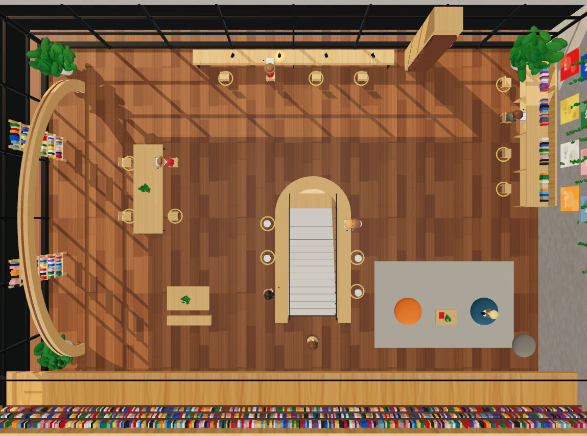

# 스터디카페

말없이 같이 공부하는 3D 온라인 스터디카페입니다. 캐릭터를 골라 빈자리에 앉고, 원하는 백색소음과 타이머로 공부합니다. 서버 없이 브라우저끼리 직접 연결됩니다.

**접속 주소:** https://jeongminimi.github.io/Study_cafe/



## 주요 기능

- **3D 카페 공간:** 통유리창, 말굽 모양 카운터, 칸막이 책상, 빈백 라운지까지 20석이 있습니다. 창밖은 실제 시각에 따라 낮, 노을, 밤으로 바뀝니다.
- **위에서 보기:** 천장을 걷어 내고 카페 전체를 한 화면에 내려다봅니다. 이 시점에서도 자리에 앉고 이동할 수 있습니다.
- **캐릭터 3종:** 남, 여, 아이 중에서 고르고 머리 색과 안경을 정합니다. 같은 방 사람에게도 고른 모습으로 보입니다.
- **작가 이름 닉네임:** 세계적으로 유명한 외국 작가 이름이 먼저 무작위로 정해지며 직접 고칠 수 있습니다.
- **상태 표시:** 학습, 휴식, 핸드폰, 자기에 따라 자세가 바뀌고 다른 사람에게 표시됩니다.
- **포스트잇 쪽지:** 앉아 있는 사람의 자리에 60자까지 쪽지를 붙입니다. 포스트잇 모양은 모두에게 보이고 내용은 받는 사람만 읽습니다.
- **학습 타이머:** 학습 시간, 쉬는 시간, 반복 횟수를 정하면 원형 타이머가 시간을 보여 줍니다.
- **쉬는 시간 알림:** 종소리, 알림창, 탭 제목으로 알려 줍니다. 허용하면 브라우저 알림도 받습니다.
- **백색소음:** 카페 웅성임, 장작불, 잔잔한 바람 중에서 고르고 크기를 조절합니다. 처음 입장하면 카페 웅성임이 나옵니다. 잔잔한 바람은 크기가 아주 조금씩 불규칙하게 오르내립니다.
- **효과음:** 연필 소리와 책장 소리가 5~10분 간격으로 불규칙하게 하나씩 나옵니다. 백색소음보다 항상 작게 들리고, 백색소음을 꺼도 작은 크기로 계속 나옵니다. 소리 패널의 **효과음 끄기**로 따로 끌 수 있습니다.
- **방 나누기:** 방마다 정원은 20명이고 최대 9관까지 있습니다. 정원이 차면 나중에 들어온 사람은 다음 관으로 옮겨집니다.

## 사용 방법

1. 캐릭터, 머리 색, 안경, 닉네임을 정하고 **입장하기**를 누릅니다.
2. 노란 동그라미가 있는 빈자리를 누르거나 **가까운 빈자리에 앉기**를 누릅니다. 앉으면 휴식 상태가 됩니다.
3. 공부를 시작하려면 **학습** 버튼을 누릅니다. 설정창에서 백색소음, 소리 크기, 학습 시간, 쉬는 시간, 반복 횟수를 정하고 **학습 시작**을 누릅니다.
4. 시간이 끝나면 쉬는 시간이 자동으로 시작되고, 쉬는 시간이 끝나면 30초 뒤 다음 세트가 시작됩니다.

| 조작 | 방법 |
|---|---|
| 이동 | 바닥 클릭 또는 터치 |
| 화면 돌리기 | 드래그 |
| 확대, 축소 | 마우스 휠 또는 두 손가락 |
| 위에서 보기 | 오른쪽 위 **위에서 보기** (드래그로 화면 이동, 다시 누르면 원래 시점) |
| 학습, 휴식, 핸드폰, 자기 | 하단 버튼 또는 숫자 키 `1` `2` `3` `4` |
| 학습 일시정지 | 학습 중 휴식, 핸드폰, 자기 선택 (학습을 누르면 이어짐) |
| 쪽지 쓰기 | 앉아 있는 사람의 자리를 누르거나 **함께** 목록의 **쪽지** |
| 쪽지 읽기 | 하단 **쪽지** 버튼 또는 내 자리의 포스트잇 |
| 쪽지 받지 않기 | **함께** 패널에서 선택 |

## 쪽지 규칙

- 받는 사람이 접속해 자리에 앉아 있을 때만 전달됩니다. 자리를 비운 사람에게는 남길 수 없습니다.
- 받는 사람이 일어나거나 자리를 옮기거나 나가면 쪽지가 사라집니다. 저장되지 않습니다.
- 같은 사람에게는 30초에 한 장만 보낼 수 있고, 한 자리에는 6장까지 붙습니다.
- 쪽지가 오면 포스트잇과 하단 버튼이 나타납니다. 소리는 나지 않습니다.
- 학습 중이 아니면 안내 문구가 잠깐 나오고, 학습 중에는 집중을 깨지 않도록 나오지 않습니다.
- 다른 탭을 보고 있으면 탭 제목에 쪽지 장수가 표시됩니다.
- 받은 쪽지에서 보낸 사람을 차단할 수 있습니다. 차단은 이번 접속 동안 유지됩니다.
- 단골 손님에게는 보낼 수 없습니다.

## 내 컴퓨터에서 실행

`index.html`을 더블클릭하면 열리지 않습니다. 이 폴더에서 아래 명령을 실행한 뒤 http://localhost:5173 을 여세요. 인터넷 연결이 필요합니다.

```bash
python -m http.server 5173
```

빌드 과정과 설치할 패키지는 없습니다.

## 배포 (GitHub Pages)

1. 저장소의 **Settings → Pages**를 엽니다.
2. **Source**를 `Deploy from a branch`로 고릅니다.
3. **Branch**를 `main`, 폴더를 `/ (root)`로 정하고 저장합니다.
4. 1~2분 뒤 `https://내아이디.github.io/저장소이름/` 으로 접속합니다.

## 파일 구조

| 바꿀 것 | 파일 |
|---|---|
| 정원, 작가 목록, 상태 이름, 머리 색, 쪽지 제한 | `js/config.js` |
| 공간, 가구, 조명, 창밖 풍경, 포스트잇 | `js/scene.js` |
| 캐릭터 모양과 자세 | `js/character.js` |
| 캐릭터의 옷과 얼굴 그림 | `js/character-art.js` |
| 효과음과 백색소음 | `js/sound.js` |
| 연필, 장작불, 카페 웅성임 녹음 파일 | `audio/pencil.wav`, `audio/fire.flac`, `audio/cafe.flac` |
| 접속과 받은 데이터 검사 | `js/net.js` |
| 입장, 좌석, 타이머, 쪽지, 시점 흐름 | `js/main.js` |
| 화면 구성과 디자인 | `index.html`, `css/style.css` |

모델과 이미지, 녹음 파일을 쓰는 소리 외의 소리는 외부 파일 없이 코드로 만듭니다. 카페 웅성임은 기본 소리라 처음 입장할 때 약 2.2MB를 받고, 장작불은 고를 때 약 3.6MB를 받습니다. `docs/screenshot.png`는 이 문서의 설명용 그림입니다.

## 개인정보

- 다른 사람에게는 닉네임, 캐릭터 모습, 자리, 상태, 오늘 공부한 시간, 내 자리의 쪽지 장수만 전달됩니다.
- 쪽지 내용은 받는 사람의 브라우저로만 직접 전달되며 어디에도 저장되지 않습니다.
- 닉네임, 설정, 공부 시간은 내 브라우저에 저장되며 별도 서버에 저장하지 않습니다.
- 브라우저끼리 직접 연결하므로 같은 방 사람의 브라우저가 내 IP 주소를 받을 수 있습니다. 입장 화면에도 안내합니다.
- 처음 서로를 찾을 때 공개 중계 서버(Nostr 릴레이)를 사용합니다.

## 알려진 한계

- 회사나 학교 네트워크처럼 직접 연결을 막는 곳에서는 다른 사람이 보이지 않을 수 있습니다. 해결하려면 TURN 서버가 필요합니다.
- 닉네임과 쪽지의 금칙어 검사는 기본 수준이고, 서버가 없어 신고 기능은 없습니다.
- 차단은 접속 단위라 상대가 새로고침하면 풀립니다.
- 탭을 오래 가려 두고 소리도 꺼 두면 브라우저가 타이머를 늦춰 알림이 최대 1분쯤 늦을 수 있습니다.
- 공부 기록은 그 브라우저에만 남아 다른 기기와 이어지지 않습니다.
- ‘단골’ 표시 캐릭터는 빈 공간을 채우는 자동 캐릭터입니다. 실제 사람이 아니고 인원수에 포함되지 않으며, 소리 패널에서 끌 수 있습니다.

## 사용한 오픈소스

- [three.js](https://github.com/mrdoob/three.js) (MIT): 3D 화면
- [Trystero](https://github.com/dmotz/trystero) (MIT): 서버 없는 연결
